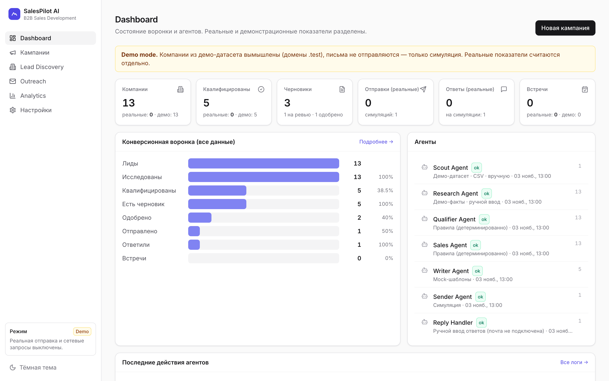
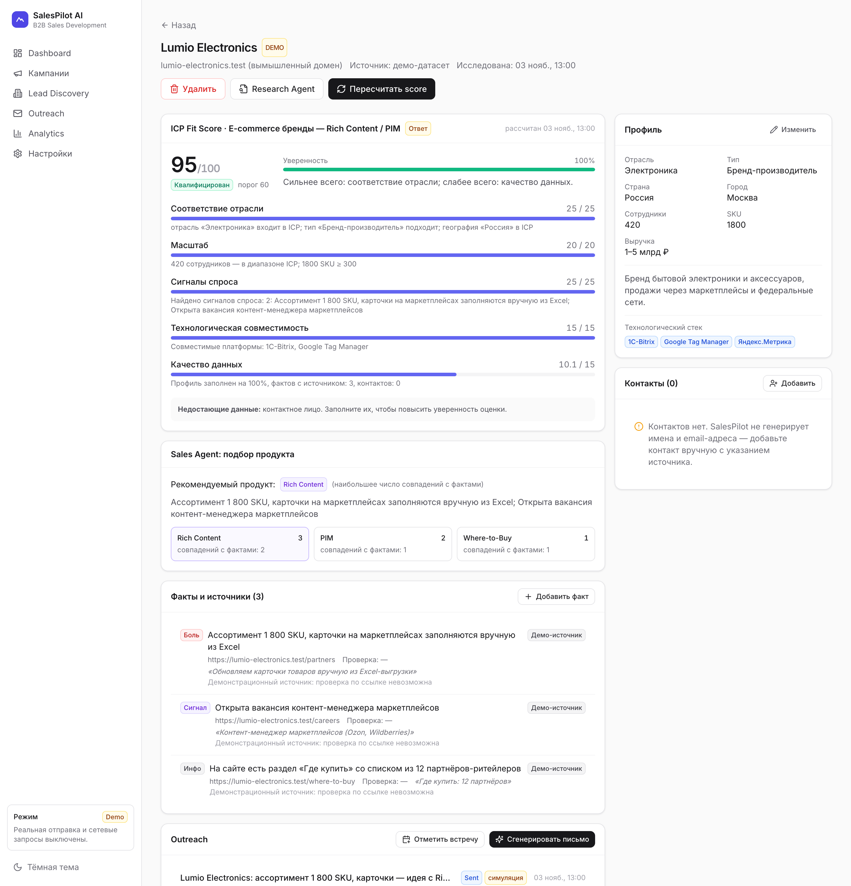
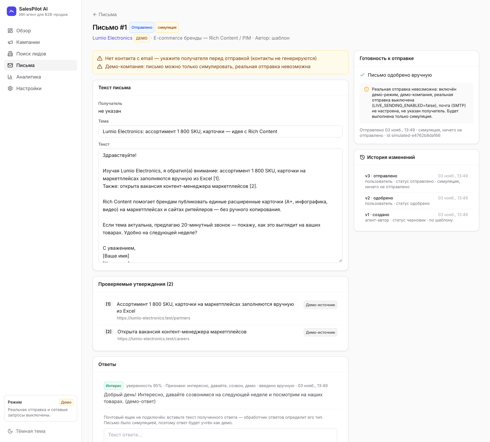
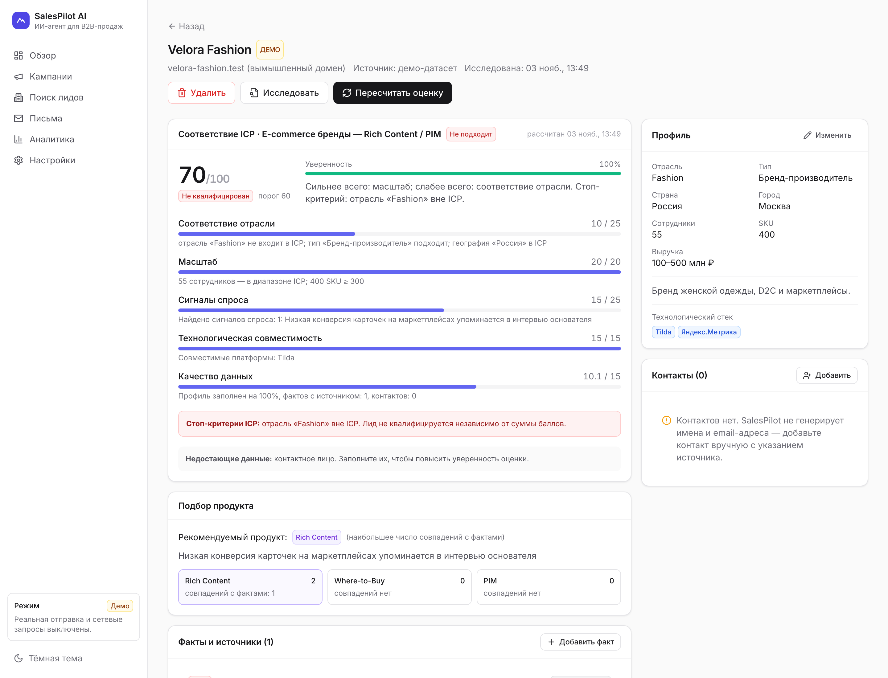
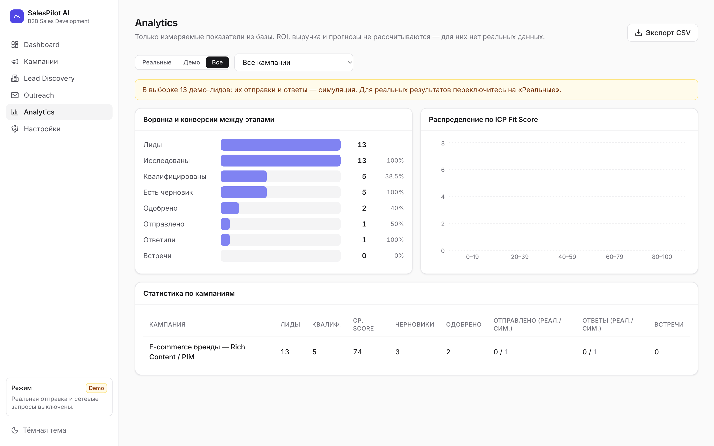

<div align="center">

# SalesPilot AI — ИИ-агент для B2B-продаж

**Находит компании-клиентов, объясняет, почему они подходят, и пишет персональные письма со ссылками на источники.
Ничего не отправляет без одобрения человека.**

[**Кейс-презентация**](https://manafkristina-max.github.io/salespilot-ai/) · [**Как показывать (DEMO.md)**](DEMO.md) · [Продуктовый кейс](CASE_STUDY.md) · [Архитектура](ARCHITECTURE.md) · [Сценарий демо](DEMO_SCRIPT.md)

[](https://github.com/manafkristina-max/salespilot-ai/actions/workflows/ci.yml)




</div>

---

## Что это за продукт

**Для кого:** менеджеры по продажам (SDR) в компаниях, которые продают брендам и производителям SaaS для e-commerce: **Rich Content** (расширенные карточки товаров), **Where-to-Buy** (виджет «Где купить»), **PIM** (управление данными о товарах).

**Какую задачу решает:** менеджер тратит часы на ручное изучение каждой компании, а ИИ-инструменты, которые это ускоряют, часто придумывают факты, имена и «встречи». SalesPilot ускоряет работу, но делает ставку на **доверие вместо автопилота**:

| Принцип | Как это работает |
|---|---|
| Объяснимость | Оценка соответствия компании идеальному клиенту (ICP) считается по 5 факторам. Для каждого показано «почему», уверенность, недостающие данные и стоп-критерии |
| Проверяемость | Каждое утверждение в письме помечено `[n]` и ведёт на факт с источником и датой проверки |
| Человек в контуре | Ручное одобрение каждого письма нельзя отключить. Есть подтверждение отправки, дневной лимит и кнопка остановки всех отправок |
| Честные данные | Контакты не генерируются. Демо-данные и симуляции никогда не попадают в реальные метрики |

## Как работают агенты

**Поиск** → **Исследование** → **Квалификация** → **Подбор продукта** → **Автор писем** → 👤 **Проверка человеком** → **Отправка** → **Обработка ответов**

| Агент | Что делает |
|---|---|
| Агент поиска | Подбирает компании под профиль клиента: демо-датасет, импорт CSV, ручное добавление |
| Агент-исследователь | Собирает факты о компании со ссылкой, цитатой и датой проверки |
| Агент квалификации | Ставит оценку 0–100 с объяснением и отсеивает компании вне профиля |
| Агент подбора продукта | Выбирает Rich Content, Where-to-Buy или PIM по найденным болям |
| Агент-автор писем | Пишет письмо только из фактов с источниками |
| Агент отправки | Отправляет только одобренное письмо и только после подтверждения |
| Обработчик ответов | Определяет тип ответа (интерес, возражение, отказ, отписка); отписавшихся добавляет в стоп-лист |

## Попробовать за 2 минуты

Нужны **Python 3.11+**, **Node.js 18+** и **git**. Ключи, почта и платные сервисы не нужны.

```bash
git clone --recursive https://github.com/manafkristina-max/salespilot-ai.git
cd salespilot-ai
./start.sh --demo
```

Браузер сам откроет **http://127.0.0.1:8000**. Флаг `--demo` при пустой базе создаёт демо-кампанию и запускает агентов: 13 вымышленных компаний, 5 подходящих лидов, 5 писем на разных этапах. Без флага откроется пустой продукт, и кампанию можно создать в интерфейсе.

- `./start.sh --reset` — сохранить текущую базу в `data/backups/` и начать с чистого демо.
- `SALESPILOT_PORT=8010 ./start.sh --demo` — другой порт.
- Остановка: `Ctrl+C`.

Что показывать и сценарий на 5 минут — в [DEMO.md](DEMO.md).

<details>
<summary>Ручная установка, разработка, тесты</summary>

```bash
python3 -m venv backend/.venv                      # нужен Python 3.11+
backend/.venv/bin/pip install -r backend/requirements.txt
git submodule update --init                        # Harvey в vendor/harvey
(cd frontend && npm install && npm run build)
cd backend && .venv/bin/python -m salespilot.seed  # по желанию: демо-данные
.venv/bin/python -m salespilot                     # http://127.0.0.1:8000
```

Интерфейс с автообновлением: `cd frontend && npm run dev` (порт 5173, запросы к `/api` идут на 8000).

Тесты:

```bash
cd backend && .venv/bin/python -m pytest -q    # 24 сценария через HTTP API
cd frontend && npm run typecheck
python3 scripts/smoke_test.py                  # сценарий пользователя на запущенном приложении
python3 scripts/check_secrets.py               # нет ли ключей и .env в файлах и истории git
```

В GitHub Actions при каждом push запускаются тесты, сборка интерфейса, проверка секретов и сборка Docker-образа со smoke-тестом внутри контейнера.
</details>

## Экраны

<table>
<tr>
<td width="50%"><br><sub><b>Объяснимая оценка.</b> Факторы, уверенность, недостающие данные, подбор продукта, факты с источниками</sub></td>
<td width="50%"><br><sub><b>Письмо с проверяемыми утверждениями.</b> Статусы, история версий, готовность к отправке</sub></td>
</tr>
<tr>
<td><br><sub><b>Стоп-критерии.</b> 70 баллов, но отрасль вне профиля клиента, поэтому компания не подходит</sub></td>
<td><br><sub><b>Аналитика.</b> Воронка, конверсии, распределение оценок, реальные и демо-данные раздельно</sub></td>
</tr>
</table>

**Разделы:** Обзор · Кампании и профиль клиента · Поиск лидов (поиск, фильтры, ручное добавление, импорт CSV, защита от дубликатов, экспорт) · Карточка компании · Письма · Аналитика · Настройки (режим, веса оценки, правила согласования, продукты, стоп-лист, подключения, журнал агентов) · светлая и тёмная тема.

**Технологии:** FastAPI · SQLite · pydantic · React 18 · TypeScript · Tailwind · Recharts.

## Демо-режим и подключение внешних сервисов

По умолчанию всё внешнее выключено. Сервисы подключаются через файл `.env` (образец в [`.env.example`](.env.example)) и переключатель «Рабочий режим» в настройках:

| Функция | По умолчанию | После подключения (реализовано, на реальных данных не проверялось) |
|---|---|---|
| Поиск компаний | демо-датасет, CSV, вручную | внешний источник не подключён |
| Исследование | демо-факты, ручной ввод | чтение публичных сайтов (`LIVE_RESEARCH_ENABLED`) |
| Написание писем | шаблоны | языковая модель Anthropic (`LLM_PROVIDER=anthropic`, платно) |
| Отправка | симуляция | почта SMTP, только при выполнении всех 9 условий безопасности |
| Ответы | вставляются вручную и классифицируются | чтение почты не реализовано |

Сервер доступен только с этого компьютера (`127.0.0.1`): входа по паролю в прототипе нет.

## Публичное демо

`Dockerfile` и `render.yaml` готовят публичную версию для [Render](https://render.com) (бесплатный план, постоянная HTTPS-ссылка). В ней принудительно включён публичный демо-режим (`SALESPILOT_PUBLIC_DEMO=true`): внешние сервисы выключены, даже если задать ключи; настройки только для просмотра; база заполняется демо-данными при старте и сбрасывается при перезапуске. Подробности и ограничения — в [DEMO.md](DEMO.md#6-публичное-демо).

## На чём основан

Перед разработкой проведён аудит открытого проекта [Harvey](https://github.com/ethanplusai/harvey) (автономный агент для продаж, лицензия MIT). Он подключён как git submodule в `vendor/harvey` и не изменяется. Через [адаптер](backend/salespilot/harvey_adapter.py) используются его модули безопасности: определение технологий сайта, защищённая загрузка страниц, защита от prompt-injection и сверка со стоп-листом. Бесконечный цикл работы, зависимость от подписки Claude и автоматическая рассылка не используются. Подробности в [ARCHITECTURE.md](ARCHITECTURE.md).

## Честно о данных

Все компании, факты и ссылки в демо-датасете вымышлены (домены в зоне `.test`, которая не существует), контактных лиц в нём нет. Продукт не запускался на реальных клиентах, поэтому реальные продажи, ответы и встречи не заявляются. Целевые метрики в кейсе — допущения для проверки.

## Структура репозитория

```
backend/salespilot/   API, агенты (service.py), оценка, внешние сервисы, адаптер Harvey, демо-данные
backend/tests/        автотесты
frontend/src/         интерфейс на React
docs/                 кейс-презентация (GitHub Pages) и скриншоты
scripts/              smoke_test.py, check_secrets.py, make_screenshots.sh, запуск двойным кликом
vendor/harvey/        Harvey (submodule)
```

## Лицензия

[MIT](LICENSE). Harvey распространяется под собственной лицензией MIT (`vendor/harvey/LICENSE`).
